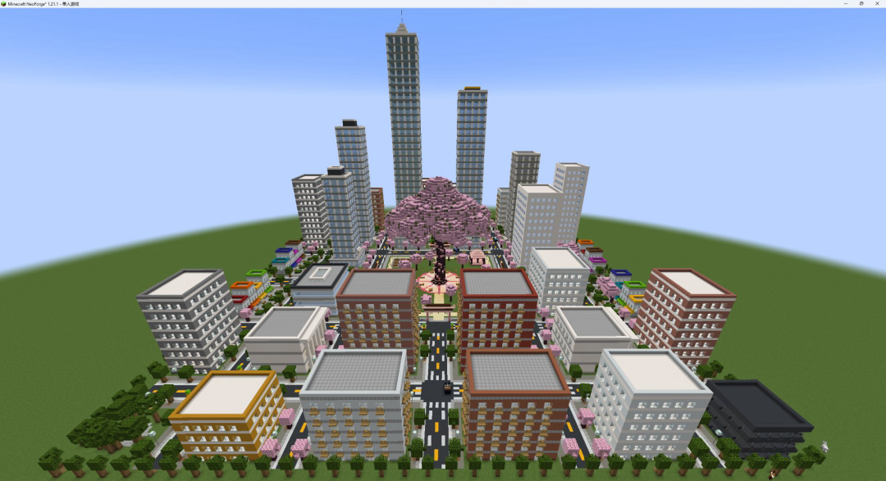
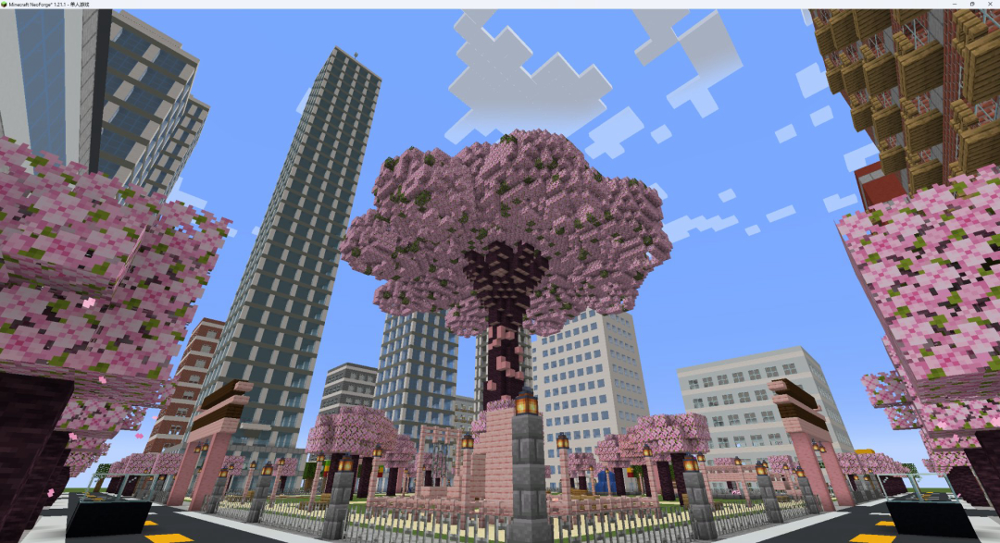

# AI Builder（NeoForge 1.21.1）

给一句话 + 一个坐标范围，在游戏里自动建造 3D 建筑。提供两条互不相干的链路：**游戏内 LLM Agent（接入大模型API）** 和 **外部 Agent（Skill + MCP）**。

## 测试指令

**建造一个完整的以公园为中心的城镇，公园里面要有一颗巨大的樱花树，以及其他设施，城镇里要有多个写字楼，街道，商业街等等，地面为 y -61
坐标范围：x -100~99 / z -100~99 / y -64~96**

效果图（Qwen4）：
外部Agent Skill建造
<p>
  
  
</p>

## 两个物品

| 物品 | 用途 |
| --- | --- |
| 建造指令 `build_commander` | **内部 Agent**：由游戏调用的模型建造 / 修改 / Plan 对话 / 视觉审查 |
| 外部建造手杖 `external_build_wand` | **外部 Agent**：只负责选坐标 + 让本地 MCP 读到任务 id，不调用任何游戏内模型 |

两者各自绑定独立的任务 id 与记忆，互不接管：内部物品不能驱动外部任务，MCP 也看不到内部任务。

## 用法

### 内部 Agent（游戏内模型）

1. 手持**建造指令**，在起点左键一次、走到终点再左键一次。用的是**玩家自身坐标**，不是准星指向的方块。
2. 右键打开 GUI，坐标框自动带入选区，也可手填。
3. 写一句需求，点「开始建造」。建过之后按钮会变成「修改建筑」——只有一个按钮，新建还是修改由任务记忆判断。
4. 「Agent 输出」页看每轮决策、深度思考、工具回执（含实际落地坐标与被拒条目）；「视觉检查」页看模型自己拍的照片。
5. 想开新任务就再合成一个物品：一个物品绑定一份记忆，不能更换。

### 外部 Agent（MCP，0 次模型调用）

1. 手持**外部建造手杖**，左键两次选好范围，**保持手持**。
2. 在本地 Agent（Codex / Claude Code / Cursor / WorkBuddy / DeepSeekHarness）里导入 `skills/minecraft-builder/`，连 `http://127.0.0.1:8765/mcp`：

   ```json
   {"mcpServers":{"minecraft-builder":{"type":"http","url":"http://127.0.0.1:8765/mcp"}}}
   ```

3. Agent 先调 `get_context` 拿到 `taskId` 与选区，然后建模、拍照、`submit_build` 提交。
4. 右键手杖，在「Agent 输出」页可看外部 Agent 的动作日志。

工具清单、坐标规则、形状表达式都在 `skills/minecraft-builder/SKILL.md`，参数 schema 由 MCP 的 `tools/list` 实时返回。

## 运行逻辑

- **外部链路的接口在客户端**：MCP 服务、几何编译、`VoxelWorld`、拍照渲染全部跑在玩家客户端；建模完成后只把最终方块分批发给服务端写世界。所以多玩家 / 多 Agent 并行不会互相覆盖，服务端也不做离屏渲染。
- **内部 Agent 跑在服务端**：模型通过 tool calling 读状态、放方块、拍照、修正，本地只负责把几何编译成体素并写进世界。
- 两条链路按任务 id 隔离；同一个任务同时只能有一个执行者。
- 坐标范围有三种确定方式：玩家左键两次、玩家在 GUI 里手动输入坐标、或外部 Agent 调用 `request_bounds` 自主设定（会写回手杖并立即生效）。写入仍受 `bounds` 约束，超出会被逐条拒绝。
- 形状没有白名单：`draw_shape` 的 `where` 是任意数学谓词（`x y z`、`cx cy cz`、`rx ry rz` 等变量，`abs/sin/clamp/lerp` 等函数），`&& || !` 即任意并集 / 交集 / 差集。

## 构建

需要 JDK 21。

```bash
./gradlew build          # 产物在 build/libs/
./gradlew runClient      # 本地开发，游戏目录在 run/（已被 git 忽略）
```

发布前把 `src/main/templates/META-INF/neoforge.mods.toml` 里的 `issueTrackerURL` / `displayURL` 占位符换成你的仓库地址，并按需改 `gradle.properties` 的 `mod_version`。

## 配置

`run/config/builder-common.toml`，最常改的几项：

```toml
[llm]
apiBase = "https://dashscope.aliyuncs.com/compatible-mode/v1"
apiKey  = "sk-..."                    # 留空 = 离线模板模式，仍可建造
model   = "deepseek-v4.1-flash-1017"  # 或 qwen3.8-max-0902 / auto

[build]
blocksPerTick      = 512          # 每 tick 写入世界的格数
maxBlocksPerTask   = 120000
maxSelectionVolume = 1000000000   # 体积软上限，默认等同不限制
echoToChat         = false        # 是否把过程输出同步到聊天栏

[agent]
agentThinking  = true   # 工具轮发送思考参数，才有深度思考
agentStream    = true   # 流式输出，思考实时可见
agentMaxRounds = 40

[visual]
visualEnabled = true
visualWidth   = 1024    # 照片分辨率
visualHeight  = 640

[mcp]
mcpEnabled = true
mcpHost    = "127.0.0.1"
mcpPort    = 8765       # 同机多开客户端时每个实例要改不同端口
mcpToken   = ""         # 填了则客户端需带 Authorization: Bearer <token>
```

其余字段与含义见配置文件里的注释。

## 常见问题

- **外部 Agent 连不上**：确认客户端日志有 `[建造] 本地 MCP 已监听 http://127.0.0.1:8765/mcp`。端口被占用会打 WARN，改 `mcpPort`。
- **`get_context` 返回 `held=false`**：玩家没拿外部建造手杖，或还没选好坐标。
- **模型报 400 `invalid_parameter_error`**：先用官方模型 ID（如 `qwen3.8-max-0902` / `auto`）；仍失败时把 `toolsSchemaMode` 在 `compat` / `full` 间切换、`toolChoice` 设 `none`、`agentThinking` 设 `false`。
- **建造中途卡住**：检查 `agentTimeoutSeconds`（默认 900 秒）与 `blocksPerTick`；日志会写明是超时、被端点拒绝还是归档。
- 不填 API Key 也能用：内部链路走离线模板，外部链路本来就不需要 Key。

## 协议与文件

- 网络载荷：`C2SAction`（GUI 动作）、`C2SCommit`（客户端提交方块）、`S2CState`（状态快照）。
- 任务记忆：`run/config/builder/memory/`（`tasks/*.json` 任务、`blocks/*.gz` 每版方块图、`selections.json` 选区）。
- 照片：客户端 `gameDirectory/builder-captures/<taskId>/`。

## 免责

模型输出不可控，可能出现造型不符预期、坐标浪费，或在自动修正时改动周围方块的情况。建议：

- 在**独立的创造模式存档**里试用，重要建筑先备份 `run/config/builder/memory/`；
- 外部 Agent 链路的选区完全由玩家手杖决定，只授予你信任的范围。

## 许可

[MIT](LICENSE)。

- 本项目不包含 Minecraft / NeoForge 的代码或素材，二者的使用遵循各自条款；
- 建造照片由本地软件渲染生成，只使用方块调色板，不使用 Mojang 贴图资源。
